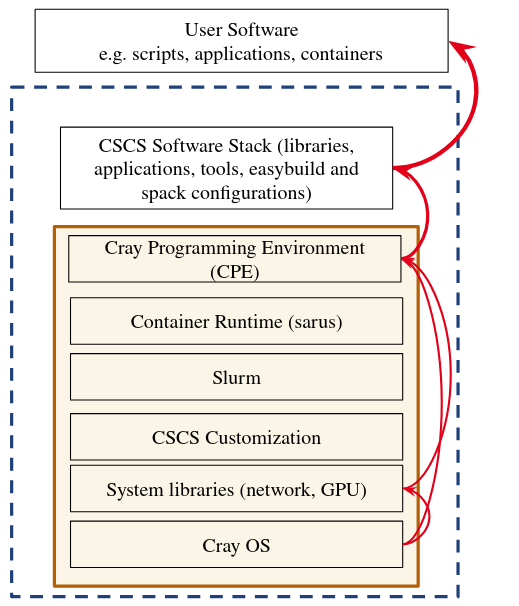
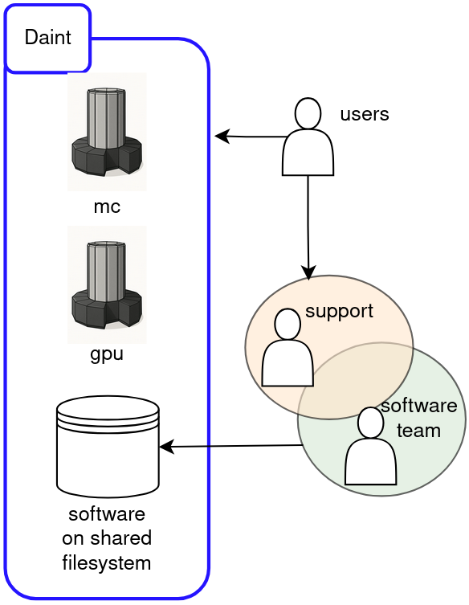
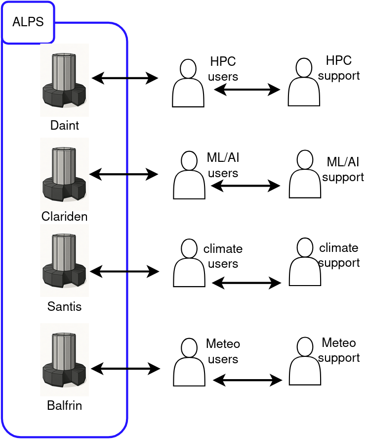
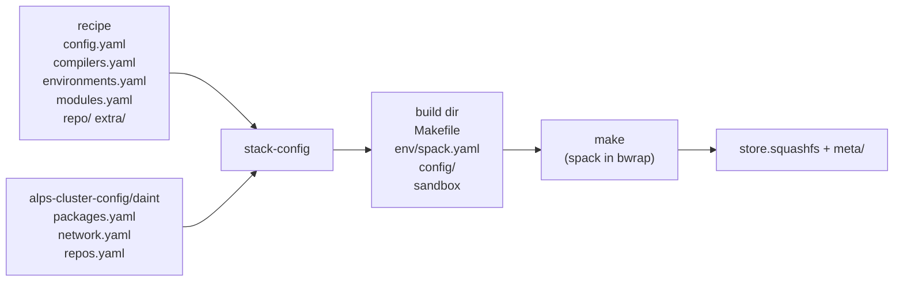
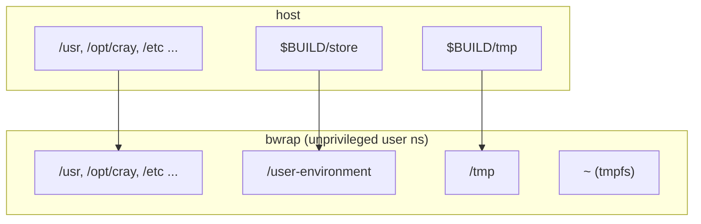
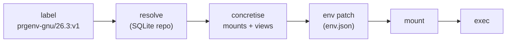
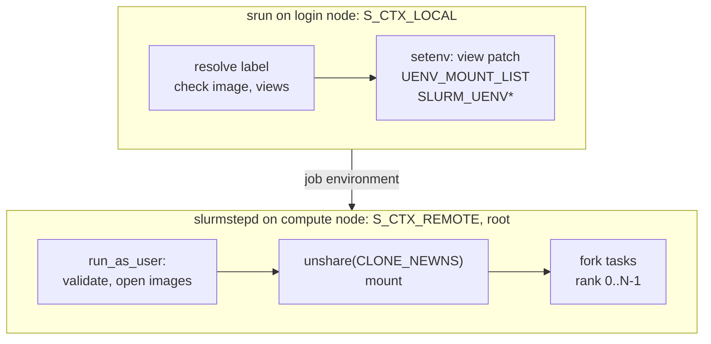
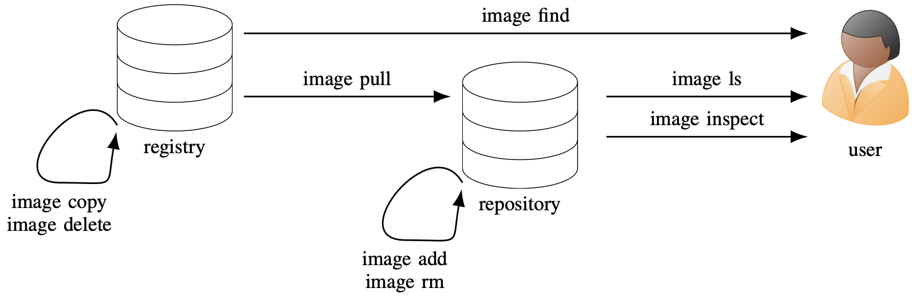
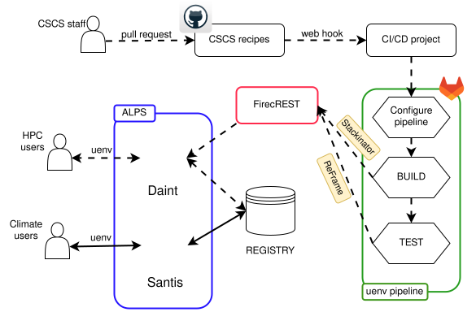
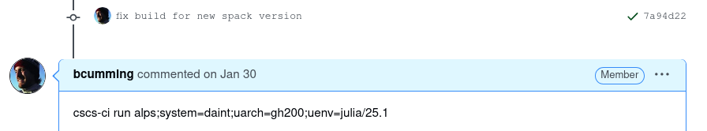

# uenv: user-space software environments on Alps

<br>

Ben Cumming, CSCS

bcumming.github.io/uenv-hpe-2026

<!--
Audience: HPE engineers who develop CPE components.
Three parts: why we built it, how HPE binaries get into a uenv, how the runtime works.
-->

---
layout: two-cols-header
layoutClass: gap-x-6
---

# A CPE update meant a new OS image and a reboot

::left::

<div class="flex justify-center">

</div>

::right::

<br>
<br>

Before Alps, CPE was installed in the base image.

A new CPE release (every 6 months) meant:
1. build a new OS image on a test system
2. reboot the production system
3. rebuild every Spack and EasyBuild stack
4. users rebuild their own software

<br>

Alps: **3,880 nodes** split into tenant clusters

| uarch | nodes | clusters |
|-------|------:|----------|
| gh200 | 2,688 | Daint, Clariden, Santis |
| zen2  | 1,024 | Eiger, Balfrin |
| a100  | 144   | Bristen, Balfrin |
| mi300/mi200 | 152 | Beverin, Besso |

Each tenant has its own users and its own upgrade schedule.

<!--
A change in any layer of the old stack forced a change in every layer above it.
On Alps one OS image upgrade schedule cannot serve ML, HPC and MeteoSwiss at the same time.
-->

---
layout: two-cols-header
---

# Requirements we set for Alps software

::left::

1. Staff install everything **as a normal user**: no root, no reboot
2. Many versions of a stack **side by side**
3. A stack is an **immutable artifact**, built from a recipe in git
4. **Rollback** means pointing at an older tag
5. Each tenant **owns** its stacks and its release schedule
6. The host OS, Slurm and the Slingshot host software (SHS) **do not change**

::right::

<div class="flex justify-center">

</div>

<div v-click class="flex justify-center mt-4">

</div>

<!--
Requirement 6 is the key one for this audience: we use the system libfabric, libcxi, xpmem and Slurm from the base image.
Everything above that is ours, and ships in a uenv.
-->

---
layout: two-cols-header
layoutClass: gap-x-6
---

# A uenv is one squashfs image mounted at a fixed path

::left::

```
images/<sha256>/
├── store.squashfs        # 300 MB - 10 GB
└── meta/                 # < 10 KB
    ├── env.json          # views: env var patches
    ├── configure.json    # build host, stackinator args
    ├── recipe/           # the full recipe
    └── extra/reframe.yaml
```

Contents of `store.squashfs`, mounted at `/user-environment`:

```
linux-<target>/             # spack install tree
env/<view>/                 # spack views + env.json
modules/                    # tcl/lmod modules
config/                     # upstream config for spack
repos/spack_repo/{alps,recipe,builtin}
meta/
```

::right::

<br>

The mount point is the install prefix.<br>
RPATHs are absolute. **Nothing is relocated**.

One file on Lustre, not 10<sup>4</sup>–10<sup>5</sup> inodes. A PyTorch venv in squashfs (22k inodes) starts up to 5× faster.

```console
$ uenv start prgenv-gnu --view=default
$ which nvcc
/user-environment/env/default/bin/nvcc
$ mount | grep /user-environment
$SCRATCH/.uenv-images/images/b8...ac5/store.squashfs
on /user-environment type squashfs
(ro,nosuid,nodev,relatime,errors=continue)
```

```console
$ uenv image ls -ahl
uenv                       arch   id                size(MB)
gromacs/2024:v1            gh200  b58e6406810279d5   3,658
prgenv-gnu/24.11:v1        gh200  b81fd6ba25e88782   4,191
prgenv-nvfortran/24.11:v2  gh200  d2afc254383cef20   8,703
pytorch/v2.6.0:1716539422  gh200  1c5e00f7556ad65d   8,124
```

<!--
The image is only visible inside the process tree that mounted it (private mount namespace).
Other users on the same login node see nothing.
-->

---
layout: section
---

# Building uenv with Stackinator

---

# Stackinator turns a recipe and a cluster config into a Makefile



```bash
stack-config -b /dev/shm/build -r alps-uenv/recipes/prgenv-gnu/26.3/gh200 -s alps-cluster-config/daint
cd /dev/shm/build
env --ignore-environment PATH=/usr/bin:/bin:`pwd -P`/spack/bin HOME=$HOME make store.squashfs NJOBS=32
```

- `stack-config` clones Spack and the package repos at the commits set in the recipe
- One Spack environment, one concretization, one `spack install`
- The build runs on a compute node of the target cluster, as the CI user

<p class="text-sm opacity-70">This talk shows Stackinator v7 (main). Most deployed recipes use the v2 format, built with the v6 release.</p>

<!--
The recipe says what software. The cluster config says what the system provides.
The same recipe builds on daint, clariden and santis because they share a network profile.
-->

---
layout: two-cols-header
layoutClass: gap-x-6
---

# Recipe: prgenv-gnu/26.3 for gh200

::left::

`config.yaml`
```yaml
name: prgenv-gnu
spack:
  repo: https://github.com/spack/spack.git
  commit: v1.1.1
  packages:
    repo: https://github.com/spack/spack-packages.git
    commit: 107d3dbd # develop on 2026-03-12
store: /user-environment
```

`compilers.yaml`
```yaml
gcc:
  version: "14"
```

<v-click>

Stackinator adds to the environment:
```yaml
specs: [cray-mpich@9.1 +cuda, "libfabric@2.2:"]
#                             ^ from network.yaml
packages:
  mpi:
    require: 'cray-mpich'
```

</v-click>

::right::

`environments.yaml` (abridged)
```yaml
gcc-env:
  compiler: [gcc]
  network:
      mpi: cray-mpich@9.1 +cuda
  unify: true
  specs:
  - boost +mpi +python ...
  - cmake
  - hdf5+cxx+hl+fortran
  - kokkos +cuda ... cuda_arch=90
  - nccl
  - aws-ofi-nccl
  - osu-micro-benchmarks
  - python   # ... 31 specs in total
  variants: [+mpi, +cuda, cuda_arch=90a]
  views:
    default:
      link: roots
      uenv:
        add_compilers: true
        prefix_paths:
          LD_LIBRARY_PATH: [lib, lib64]
```

<!--
The recipe only names cray-mpich and a version. libfabric, PMI, GTL, PALS come in through the cluster config and the site package repo.
-->

---
layout: two-cols-header
layoutClass: gap-x-6
---

# The cluster config describes what the system provides

::left::

```
alps-cluster-config/
├── daint/
│   ├── packages.yaml   # gcc, slurm, xpmem, rdma-core
│   ├── repos.yaml      # ../site/spack_repo/alps
│   └── network.yaml -> ../site/network/gh200/network.yaml
├── clariden/  santis/  eiger/  bristen/ ... (11)
└── site/
    ├── network/{gh200,zen,a100,amdgpu}/network.yaml
    └── spack_repo/alps/packages/
        ├── cray_mpich/   cray_gtl/
        ├── cray_pmi/     cray_pals/
        └── nvhpc/
```

The `versions` script runs `rpm -q` on a compute node (libfabric, libcxi, cxi-driver, cassini-headers, slurm, xpmem) to fill these files.

Merge order: `system | network | recipe`

Repo order: `recipe` > `alps` > `builtin`

::right::

`site/network/gh200/network.yaml` (abridged)
```yaml
mpi:
  cray-mpich:
    specs: ["libfabric@2.2:"]
  openmpi:
    specs: ["libfabric@2.2: fabrics=lnx,shm,xpmem"]
packages:
  cray-mpich:
    buildable: true
    prefer: ['+cuda', '@8.1.32']
  libfabric:
    buildable: true
    externals:
    - spec: libfabric@1.22.0 fabrics=cxi,rxm,tcp,rxd,udp,shm +cuda
      prefix: /opt/cray/libfabric/1.22.0
    - spec: libfabric@1.15.2.0 fabrics=cxi,rxm,tcp,rxd,udp +cuda
      prefix: /opt/cray/libfabric/1.15.2.0
    prefer: ['@2.2:', '+cuda', '+gdrcopy']
    require: fabrics=cxi,rxm,tcp
  libcxi:
    buildable: false
    externals:
    - spec: libcxi@13.1.0 +cuda
      prefix: /usr
  cxi-driver:      # same: 13.1.0 in /usr
  cassini-headers: # same: 13.1.0 in /usr
```

<!--
libfabric 2.2 is built from source with the upstream Spack package, linked against the system libcxi.
The SHS libfabric in /opt/cray is still available as an external.
-->

---
layout: two-cols-header
layoutClass: gap-x-6
---

# The build runs as a normal user in a bwrap sandbox

::left::

`etc/bwrap-mutable-root.sh`
```bash
for d in /*; do
    # skip invalid symlinks, as they will break bwrap
    if [ ! -L "$d" ] || [ -e "$d" ]; then
        args+=("--dev-bind" "$d" "$d")
    fi
done
bwrap "${args[@]}" "$@"
```

`templates/sandbox`
```bash
exec $BUILD/bwrap-mutable-root.sh \
	--tmpfs ~ \
	--bind $BUILD/tmp /tmp \
	--bind $BUILD/store /user-environment \
	"$@"
```

Spack `config.yaml`: `install_tree: root: /user-environment`

::right::



Spack installs into the final path. Binaries, RPATHs, `.pc` files and wrappers are correct when the image is mounted.

Environment set in `Make.user`:
```make
SPACK_USER_CONFIG_PATH   := ~    # tmpfs
SPACK_SYSTEM_CONFIG_PATH := $(BUILD_ROOT)/config
SPACK_USER_CACHE_PATH    := $(BUILD_ROOT)/cache
LC_ALL := en_US.UTF-8
TZ     := UTC
SOURCE_DATE_EPOCH := 315576060   # DOS epoch, for wheels
```

<!--
No root and no fakeroot at any point in the build.
The host / is visible, so system externals (libcxi in /usr, slurm) are used as on the real system.
-->

---

# Make targets, from Spack install to squashfs

<div class="grid grid-cols-2 gap-6">
<div>

| target | action |
|---|---|
| `spack-setup` | `spack bootstrap now` |
| `mirror-setup` | trust buildcache keys |
| `env/spack.lock` | `spack concretize --force` |
| `install` | `spack install --jobs $(NJOBS)` |
| `cache-push` | `spack buildcache create` |
| `compiler-config.yaml` | built compilers → externals |
| `views` | `activate.sh` → `env.json` per view |
| `generate-config` | `config/{upstreams,packages,repos}.yaml` |
| `modules-done` | `spack module tcl refresh` |
| `env-meta` | `meta/env.json` |
| `post-install` | recipe hook in the sandbox |
| `store.squashfs` | `mksquashfs` |

</div>
<div>

```make
store.squashfs: env-meta post-install cache-push
  $(SANDBOX) find $(STORE)/repos -type d \
      -name __pycache__ -exec rm -r {} +
  $(SANDBOX) chmod -R a+rX $(STORE)
  $(SANDBOX) env -u SOURCE_DATE_EPOCH $(MKSQUASHFS) \
      $(STORE) $@ \
      -force-uid nobody -force-gid nobody \
      -all-time $$(date +%s) \
      -no-recovery -noappend -Xcompression-level 3
```

<p class="text-sm opacity-70">abridged: <code>$(MKSQUASHFS)</code> is the mksquashfs that Spack built in the same environment</p>


- Compilers are spec groups in the same environment, with `needs: [gcc]`
- `cache-push` pushes every package to a Spack build cache, so a rebuild reuses binaries
- `config/` and `repos/` ship in the image: users run `spack` with the uenv as an **upstream**, and get the same `cray-mpich` package definition

</div>
</div>

<!--
The image contains the package.py files that installed it. A user build on top of a uenv uses the same cray-mpich definition and the same installed prefix.
-->

---
layout: section
---

# HPE binaries in a uenv

---
layout: two-cols-header
layoutClass: gap-x-6
---

# cray-mpich, cray-gtl, cray-pmi and cray-pals are Spack packages

::left::

1. HPE RPMs from `update1.linux.hpe.com/repo/cpe/...` (HPE Passport token)
2. CSCS repackages them by hand, out of tree, into `cray-mpich-<ver>.<arch>.tar.gz` on jfrog:
   - one subtree per compiler: `mpich-gcc/`, `mpich-nvhpc/`, `mpich-intel/`
   - hard-coded paths replaced by `@@CC@@`, `@@PREFIX@@`, `@@GTL_LIBRARY@@`
3. A Spack package in `site/spack_repo/alps` installs the tarball

CCE, libsci and the craype wrappers are not used.

::right::

`cray_mpich/package.py`
```python
_versions = {
    "9.2.1": {
        "Linux-aarch64": "efeb6c7772a81884c766...",
        "Linux-x86_64": "f3f805c81e9455249a0c...",
    },
    # ... 16 versions: 8 for both arches, 8 for one
}

class CrayMpich(MpichEnvironmentModifications, Package):
    for ver, packages in _versions.items():
        key = "{0}-{1}".format(platform.system(),
                               platform.machine())
        sha = packages.get(key)
        if sha:
            version(ver, sha256=sha,
                preferred=(ver == "8.1.32"),
                url=f"https://jfrog.svc.cscs.ch/artifactory/"
                    f"cray-mpich/cray-mpich-{ver}.{platform.machine()}.tar.gz")
    provides("mpi")
```

| HPE binary | from the system | built by Spack |
|---|---|---|
| cray-mpich, cray-gtl | libcxi, cxi-driver, cassini-headers | libfabric 2.x, cuda |
| cray-pmi, cray-pals | xpmem, slurm | compilers, everything else |

<!--
The repackaging step takes the RPMs for each PrgEnv build of cray-mpich and puts them into one tarball with a subtree per compiler family.
Hard-coded paths in the wrappers are replaced with placeholders that the Spack package fills in.
-->

---
layout: two-cols-header
layoutClass: gap-x-6
zoom: 0.82
---

# What the cray-mpich package does at install time

::left::

```python
def install(self, spec, prefix):
    if "%fortran=nvhpc" in self.spec:
        install_tree("mpich-nvhpc", prefix)
    elif "%fortran=gcc" in self.spec or "%fortran=llvm" in self.spec:
        install_tree("mpich-gcc", prefix)
    elif "%fortran=oneapi" in self.spec or "%fortran=intel" in self.spec:
        install_tree("mpich-intel", prefix)
    else:
        raise InstallError("Unsupported toolchain for cray-mpich")

def get_rpaths(self):
    pkgs = os.getenv("SPACK_RPATH_DIRS", "").split(":")
    pkgs_store = os.getenv("SPACK_STORE_RPATH_DIRS", "").split(":")
    compilers = os.getenv("SPACK_COMPILER_IMPLICIT_RPATHS", "").split(":")
    return ":".join([p for p in pkgs + compilers + pkgs_store if p])
```

::right::

```python
@run_after("install")
def fixup_binaries(self):
    rpath = self.get_rpaths()
    for f in elf_files(self.prefix):
        patchelf("--force-rpath", "--set-rpath", rpath, f)
        patchelf("--add-needed", "libxpmem.so", f)
        for l in self.spec["cray-pmi"].libs.names:
            patchelf("--add-needed", l, f)
        if "+cuda" in self.spec:
            patchelf("--add-needed", "libmpi_gtl_cuda.so", f)
        if "+rocm" in self.spec:
            patchelf("--add-needed", "libmpi_gtl_hsa.so", f)

@run_after("install")
def fixup_compiler_paths(self):
    filter_file("@@CC@@",  self.compiler.cc,  self.prefix.bin.mpicc)
    filter_file("@@CXX@@", self.compiler.cxx, self.prefix.bin.mpicxx)
    filter_file("@@FC@@",  self.compiler.fc,  self.prefix.bin.mpifort)
    # also @@PREFIX@@ and @@GTL_LIBRARY@@:
    #   -L{gtl} -Wl,-rpath,{gtl} -lmpi_gtl_cuda
```

The same pattern is used for cray-gtl, cray-pmi and cray-pals: download, `install_tree`, `patchelf` every ELF file, fill `@@PREFIX@@` in `.pc` files.

<p class="text-sm opacity-70">abridged from alps-cluster-config/site/spack_repo/alps/packages/cray_mpich/package.py</p>

<!--
--add-needed makes libmpi pull in PMI, xpmem and GTL when an application links with it. Without that, applications built with plain mpicc fail to load GTL at runtime ("GPU_SUPPORT_ENABLED is requested, but GTL library is not linked").
The RPATH comes from Spack-internal variables. SPACK_RPATH_DIRS became empty on Spack develop, so SPACK_STORE_RPATH_DIRS was added.
-->

---
zoom: 0.9
---

# Dependency information we maintain by hand

| constraint | how we encode it | file |
|---|---|---|
| cray-mpich needs the GTL of the same release | 16-entry list: `depends_on(f"cray-gtl@{ver} +cuda", when="@"+ver)` | `cray_mpich:122-143` |
| cray-mpich → cray-pmi | `cray-pmi@:6.1.15` for `@:8.1.32,=9.0.0`<br>`cray-pmi@6.1.16:` for `@8.1.33,9.0.1:` | `cray_mpich:147-151` |
| cray-pmi 6.1.16 needs a newer glibc | comment: *"cray-pmi@6.1.16 is linked to glibc from sles15sp6"* | `cray_mpich:149` |
| cray-pmi → cray-pals | exact pins: `@6.1.13:` → `1.3.2`, `@6.1.10` → `1.2.11`, ... (7 rules) | `cray_pmi:83-89` |
| cray-pmi 6.1.18 → openssl | `depends_on("openssl@3:")` to avoid an SSL symbol clash | `cray_pmi:90` |
| cray-gtl → CUDA major version | `cuda@11` `@:8.1.26`, `cuda@12` `@8.1.27:9.0`, `cuda@13:` `@9.1:` | `cray_gtl:101-104` |
| GTL 8.1.27 has no `DT_NEEDED` on CUDA | `patchelf --add-needed libcudart.so libcuda.so` | `cray_gtl:150-152` |
| GTL is linked to `libamdhip64.so.6` | `patchelf --replace-needed libamdhip64.so.6 libamdhip64.so.7` | `cray_gtl:153-154` |
| libmpi has no `DT_NEEDED` on PMI, xpmem, GTL | `patchelf --add-needed ...` | `cray_mpich:195-205` |
| patchelf 0.18 breaks these binaries | `patchelf: require: "@:0.17"` on every cluster (NixOS/patchelf#492) | `*/packages.yaml` |
| some versions exist for one arch only | `_versions` table keyed on `platform.machine()` | all four packages |

None of this is in a machine-readable form from HPE: we find it when a build or a job fails.

<!--
Every row here was a support ticket or a failed CI pipeline first.
-->

---
layout: two-cols-header
---

# An RPM installs into `/opt/cray` on one OS

::left::

### What an RPM gives us

- A fixed prefix: `/opt/cray/pe/...`
- Built for one SLES service pack and glibc
- `Requires:` on package names, not on ABI or version ranges
- One RPM per PrgEnv build of the same library
- Needs root and the rpm database to install
- Repo needs an HPE Passport token, and is marked *experimental*
- Packages missing from the repo: `libpals` (CPE-25.03, aarch64), `libxpmem` (CPE-24.07, x86_64)

::right::

### What Spack needs to install a package

- A versioned archive with a sha256
- Relocatable: installs into any prefix
- Dependencies with version ranges
- Correct `DT_NEEDED` and `RUNPATH`
- `.pc` files and wrappers that use the install prefix
- A list of what is inside (an SBOM)

::bottom::

<div class="mt-6">

libfabric, libcxi and cassini-headers are open source. We **build them from source** with Spack today: `libfabric@2.2:` on gh200, and the full CXI stack from `shs-13.0.0` on the AMD GPU clusters. That needs no repackaging and no `patchelf`.

</div>

<!--
Keep this factual. The contrast between the closed-source and the open-source parts of the stack makes the point.
-->

---
layout: section
---

# The uenv runtime

---
layout: two-cols-header
layoutClass: gap-x-6
---

# Four components, one C++20 code base

::left::

| component | built as | lines |
|---|---|---:|
| `uenv` CLI | static executable | 5.9k |
| `squashfs-mount` | setuid root, mode 4755 | 0.5k |
| SPANK plugin | `libslurm-uenv-mount.so` | 1.0k |
| `libuenv` (env, mount, repo, OCI, util) | static library | 21k |

The CLI links all dependencies statically:<br>
fmt, spdlog, nlohmann_json, sqlite3, libcurl, OpenSSL, zlib, libarchive, toml++

`ldd uenv` shows only `libc`, `libstdc++`, `libm` and `libgcc_s`. CI checks this.

::right::



Tests and release:
- 313 Catch2 unit test cases
- BATS suites: cli, completion, slurm, squashfs-mount, registry (against a real zot registry)
- CI runs every suite with asan, lsan, ubsan and tsan, for both mount backends, as an unprivileged user against an installed setuid binary
- RPMs for SLES 15.5–15.7 × Slurm 23.02, 24.05, 25.05 × x86_64, aarch64

<!--
The privileged code is small: the setuid main, mount_kernel.cpp, privilege.cpp and mount.cpp are about 1.1k lines.
-->

---

# `uenv run` builds the environment, then execs the setuid helper

<div class="grid grid-cols-2 gap-6">
<div>

`src/cli/run.cpp` (unprivileged)
```cpp
auto runtime_environment = generate_environment(
    *env, settings.calling_environment, "SQFSMNT_FWD_");

std::vector<std::string> mounts;
for (auto m : env->uenvs) {
    mounts.push_back(fmt::format("{}:{}",
        m.second.sqfs_path.string(),
        m.second.mount_path));
}

const auto commands = uenv::squashfs_mount_args(
    settings.calling_environment, mounts,
    args.join, settings.verbose, args.commands);

auto c_env = runtime_environment.c_env();
auto error = util::exec(commands, c_env);
```

</div>
<div>

```console
$ uenv run prgenv-gnu/26.3:v1,linaro-forge/26.0:v1 \
      --view=default -- ./a.out
```
execs:
```console
squashfs-mount \
  --sqfs=$IMG1/store.squashfs:/user-environment,\
         $IMG2/store.squashfs:/user-tools \
  -- ./a.out
```

Checks before the mount:
- one image per mount point
- the same image is not mounted twice
- two uenvs with the same name is an error
- mount points are absolute, and exist or are inside another mount
- mounts are sorted parent before child

`uenv start` is the same, with `$SHELL` as the command. It requires a TTY.

</div>
</div>

<!--
The CLI does all the resolution work unprivileged: repo lookup, metadata, view selection.
The helper only gets a list of file:mountpoint pairs and a command.
-->

---
zoom: 0.92
---

# squashfs-mount: work as the user, become root only to mount

| # | euid | step | code |
|--:|:--:|---|---|
| 1 | 0 | read real/effective/saved ids; refuse if installed setgid | `getresuid`, `getresgid` |
| 2 | **user** | drop the effective uid to the caller | `seteuid(ruid)` |
| 3 | user | parse and validate mounts; open each image **as the user** | `open(O_RDONLY\|O_CLOEXEC\|O_NOFOLLOW)` |
| 4 | **0** | reclaim root; `setreuid` restores the effective capability set | `seteuid(0)`, `setreuid(0,0)` |
| 5 | 0 | new mount namespace, no propagation back to the host | `unshare(CLONE_NEWNS)`, `mount("/", MS_SLAVE\|MS_REC)` |
| 6 | 0 | check `hsqs` magic on the fd; bind the user's fd to a free loop device | `pread`, `LOOP_CTL_GET_FREE`, `LOOP_CONFIGURE(RO\|AUTOCLEAR)` |
| 7 | 0 | mount the image | `mount(loop, mnt, "squashfs", MS_RDONLY\|MS_NOSUID\|MS_NODEV)` |
| 8 | **user** | drop gid then uid; read ids back; no new privileges | `setresgid`, `setresuid`, `PR_SET_NO_NEW_PRIVS` |
| 9 | user | restore forwarded env vars, set `UENV_MOUNT_LIST` | `execvpe` |

- `LOOP_CONFIGURE` binds a **descriptor**, and permission is checked at `open(2)`. The path is never opened as root, so there is no TOCTOU window.
- `setresgid`: the saved set-group-id survives `execve`, and `NO_NEW_PRIVS` does not stop a process from regaining a saved id.
- No libmount: from util-linux 2.42 it refuses mounts from a setuid process without an fstab entry.
- `LO_FLAGS_AUTOCLEAR`: the loop device detaches when the last process in the namespace exits.

<!--
Source: src/squashfs-mount/squashfs-mount-kernel.cpp, src/uenv/mount_kernel.cpp, src/util/privilege.cpp.
Validation in step 3 runs as the user on purpose: as root it would be an oracle for whether arbitrary paths exist and what their first 4 bytes are.
-->

---
layout: two-cols-header
layoutClass: gap-x-6
---

# The environment is a declarative patch, passed to `execvpe`

::left::

`meta/env.json` (simplified)
```json
"views": {
  "default": {
    "root": "/user-environment/env/default",
    "env": {
      "version": 1,
      "type": "spack-view",
      "values": {
        "list": {
          "PATH": [{"op": "prepend",
            "value": ["/user-environment/env/default/bin"]}],
          "LD_LIBRARY_PATH": [{"op": "prepend",
            "value": [".../default/lib", ".../default/lib64"]}]
        },
        "scalar": {"CUDA_HOME": "/user-environment/...",
                   "SPACK_ROOT": null}
}}}
```

List ops: `prepend`, `append`, `set`, `unset`. Scalar `null` unsets.
Values can refer to other variables with `${@VAR@}`.

::right::

glibc removes `LD_LIBRARY_PATH`, `LD_PRELOAD` and the other `unsecvars.h` variables from the environment of a setuid process (`AT_SECURE`).

The CLI saves a copy under a prefix:
```cpp
if (unsecure_envvars__.contains(e.first)) {
    secure_vars.push_back(
        {secure_prefix.value() + e.first, e.second});
}
```

The helper restores them after dropping root:
```cpp
for (auto& [name, v] : calling_env.variables()) {
    if (name.starts_with("SQFSMNT_FWD_")) {
        runtime_env.set(name.substr(12), v);
    }
}
```

- No `getenv`: a snapshot of `envp` is patched and passed to `execvpe`. Works for any shell.
- uenv v1 printed `export` lines for the shell to `eval`. We removed that.

<!--
Views are generated by stackinator from spack's activate.sh, then cleaned: SPACK_* variables, /usr/bin and build paths are removed.
-->

---
layout: two-cols-header
layoutClass: gap-x-6
---

# Slurm: mount once per node, before the tasks fork

::left::



`slurm_spank_init` registers `--uenv`, `--view`, `--repo`, `--no-default-view` and `--uenv-passthrough`.

`slurm_spank_init_post_opt` does the work, in both contexts.

::right::

`run_as_user` drops to the job's uid, gid and supplementary gids on **one thread**, with raw syscalls:

```cpp
int raw_setresuid(uid_t uid) {
    return static_cast<int>(
        ::syscall(SYS_setresuid, uid, uid, uid));
}
```

glibc's `setresuid` changes every thread of the process. slurmstepd is already serving RPCs on other threads at this point, and must stay root.

Other cases the plugin handles:
- `srun` inside `uenv start`: the mounted uenv and its env are forwarded to the compute nodes
- `#SBATCH --uenv` is replayed by Slurm for each `srun`: detected, not mounted twice
- `sbatch` from inside a uenv session: an error by default, `--uenv-passthrough=use|ignore` to override

<!--
The kernel backend does not use the setuid helper in Slurm: the remote init_post_opt hook already runs as root in slurmstepd.
-->

---

# Rootless backend: the same tool without setuid

Built with `meson setup -Dmount_backend=fuse`. One binary contains exactly one backend.

<div class="grid grid-cols-2 gap-6">
<div>

One process (`uenv run`, `uenv start`):
1. `unshare(CLONE_NEWUSER|CLONE_NEWNS)`
2. write `0 <uid> 1` to `uid_map`, `deny` to `setgroups`, `0 <gid> 1` to `gid_map`
3. fork a `squashfuse_ll` daemon, tied to the parent with `PR_SET_PDEATHSIG`
4. second user namespace to map back to the real uid and gid
5. `PR_SET_NO_NEW_PRIVS`, exec

</div>
<div>

N tasks on one node (Slurm `task_init`):
- tasks elect a leader with named semaphores and a process-shared robust mutex
- the leader mounts and forks a **mount supervisor**; the daemons are tied to the supervisor, not to a rank
- the others `setns()` into the leader's user and mount namespaces, after checking the leader's start time in `/proc/<pid>/stat` (pid reuse)
- if one task fails during setup, all tasks fail
- the supervisor ends when slurmstepd kills the step's cgroup

</div>
</div>

<!--
This is for sites, or containers, where a setuid binary is not allowed.
The robust mutex is left ENOTRECOVERABLE on purpose if the leader dies during setup.
-->

---
layout: two-cols-header
layoutClass: gap-x-6
---

# Images are OCI artifacts. The local repo is SQLite.

::left::

Label: `name/version:tag@system%uarch`

`prgenv-gnu/26.3:v1@daint%gh200`

Registry path: `<ns>/<system>/<uarch>/<name>/<version>:<tag>`
- artifactType `application/x-squashfs`, one layer `store.squashfs`
- `meta/` as tar.gz, attached as a referrer with artifactType `uenv/meta`
- namespaces: `build::` (CI), `deploy::` (users), `service::`

Native OCI client (replaced the `oras` CLI):
- manifest digest is computed from the response body, never taken from `Docker-Content-Digest`
- blobs are hashed while they stream to disk
- image id = manifest digest
- `image copy build:: deploy::` uses cross-repository blob mount: no data is copied

::right::

```sql
CREATE TABLE images (
  sha256 TEXT PRIMARY KEY CHECK(length(sha256)==64),
  id     TEXT UNIQUE CHECK(length(id)==16),
  date   TEXT NOT NULL,
  size   INTEGER NOT NULL);
CREATE TABLE uenv (
  version_id INTEGER PRIMARY KEY,
  system TEXT NOT NULL, uarch TEXT NOT NULL,
  name TEXT NOT NULL, version TEXT NOT NULL,
  UNIQUE (system, uarch, name, version));
CREATE TABLE tags (
  version_id INTEGER, tag TEXT NOT NULL,
  sha256 TEXT NOT NULL, ...);
CREATE VIEW records AS ...;
CREATE TRIGGER delete_orphan_uenv ...;
CREATE TRIGGER delete_orphan_image ...;
```

<div class="flex justify-center">

</div>

<!--
uenv image find queries a listing service; the JSON result is loaded into an in-memory SQLite repo and queried with the same code as the local repo.
-->

---
layout: section
---

# Build, test, deploy

---
layout: two-cols-header
layoutClass: gap-x-6
---

# Every uenv is built, tested and deployed from git

::left::

`eth-cscs/alps-uenv`: **28** uenv, **66** versions, **146** recipes (version × uarch), **152** deployments on **9** clusters and **6** uarch.

1. PR comment: `cscs-ci run alps;system=daint;uarch=gh200;uenv=cp2k:2025.1`
2. GitLab pipeline, FirecREST runner: build in a Slurm job **on the target cluster**
3. ReFrame tests from `meta/extra/reframe.yaml`
4. push to `build::daint/gh200/cp2k/2025.1:<job-id>`
5. a person runs `uenv image copy build::... deploy::...`

`uenv build myapp/1.0@daint%gh200 ./recipe` sends a recipe to the same service.

::right::

<div class="flex justify-center">

</div>

<div class="flex justify-center mt-2">

</div>

<!--
Communities (C2SM, MeteoSwiss) run the same pipeline for their own recipes.
Two years in production with one breaking change: libfabric moved location after an SHS upgrade.
-->

---

# Demo

<style>
.slidev-code { font-size: 0.8rem !important; }
</style>

<div class="grid grid-cols-2 gap-6">
<div>

```bash
# find and pull
uenv image find prgenv-gnu
uenv image pull prgenv-gnu/26.3:v1

# mount namespace of the login shell
readlink /proc/self/ns/mnt

uenv start prgenv-gnu/26.3:v1 --view=default

# a new mount namespace, and the image
readlink /proc/self/ns/mnt
grep user-environment /proc/self/mountinfo
env | grep ^UENV_
```

</div>
<div>

```bash
# how cray-mpich was installed
mpicc -show
readelf -d $(dirname $(which mpicc))/../lib/libmpi.so \
    | grep -E 'NEEDED|RPATH|RUNPATH'

exit

# Slurm: one namespace per node, shared by the ranks
srun -N2 -n8 --uenv=prgenv-gnu/26.3:v1 \
    bash -c 'echo $(hostname) $(readlink /proc/self/ns/mnt)'
```

</div>
</div>

<!--
See demo.md for the full script and what to point out.
-->

---

# Summary

- A uenv is a squashfs image built by Spack at its final path, and mounted read-only in a private mount namespace
- The build runs as a normal user in a bwrap sandbox, on the target cluster, from a recipe in git
- HPE binaries are installed by Spack packages that download a repackaged tarball, set RPATHs and add missing `DT_NEEDED` entries
- The runtime is a small, tested C++ code base: an unprivileged CLI, a setuid helper that only mounts, and a SPANK plugin

<br>

| | |
|---|---|
| uenv | github.com/eth-cscs/uenv |
| stackinator | github.com/eth-cscs/stackinator |
| cluster config | github.com/eth-cscs/alps-cluster-config |
| recipes | github.com/eth-cscs/alps-uenv |
| docs | docs.cscs.ch |

<br>

## Questions

---
layout: section
---

# Backup

---
layout: two-cols-header
layoutClass: gap-x-6
---

# Backup: OpenMPI on the same network stack

::left::

`site/network/gh200/network.yaml`
```yaml
mpi:
  openmpi:
    specs: ["libfabric@2.2: fabrics=lnx,shm,xpmem"]
packages:
  openmpi:
    buildable: true
    require:
      - 'schedulers=slurm'
      - 'fabrics=cma,ofi,xpmem'
      - '+internal-pmix'
      - '+cray-xpmem'
    prefer:
      - '@5.0.9:'
      - '+cuda'
```

::right::

A recipe selects it with:
```yaml
network:
  mpi: openmpi
```

OpenMPI and libfabric are built from source against the system libcxi and xpmem. No binary from HPE is in this stack.

`prgenv-gnu-openmpi/26.3` pins `libfabric@2.3` because of open-mpi/ompi#13582 and ofiwg/libfabric#11900, #12036.

---

# Backup: label resolution

Grammar: `[ns::]name[/version][:tag][@system|*][%uarch]`

- `@` and `%` may come in either order. `:` followed by a path is a mount point.
- A 16-hex-digit or 64-hex-digit name is also matched against the `id` and `sha256` columns
- Resolution fails if the matching records have different sha256
- Default system: `CLUSTER_NAME` → `/etc/uenv/config.toml` → `~/.config/uenv/config.toml` → `--system`
- Inputs are lexed and parsed, not matched with regex: `src/util/lex.cpp`, `src/uenv/parse.cpp`

```console
$ uenv run prgenv-gnu/26.3:v1@daint%gh200:/user-environment -- cmd
$ uenv run b81fd6ba25e88782 -- cmd
$ uenv run ./store.squashfs:/user-environment -- cmd
```
